# Canlı İmplementasyon Modülü – UX Bulguları (Jira raporu taslağı)

Canlı ortam (sdp.dakika.com.tr/implementation/processes) ile prototip karşılaştırılarak tespit edilen değişiklikler. Validasyon hata/uyarı mesaj metinleri ayrı rapordadır: "Validasyon UX Düzenlemeleri – Hata ve Uyarı Mesajları".
Durum: Bölüm 1–9 kesinleşti ve prototipe uygulandı (15 Eki 2026; müşteri validasyon modalı canlıya göre güncellendi: yalnızca Hata/Uyarı, uyarı mor). Sıradaki adım: tek toplu Jira raporu.

Ekran görüntüleri prototipten alınmıştır (`docs/ss/`, 1440×900). Yeniden almak için: `docs/ss/capture.mjs`.

Genel dil kuralı: Emir kipi kullanılmaz; bilgilendirici dil ("…gerekmektedir", "…önerilir"). Müşteri ve operasyon (implementasyon uzmanı) için ayrı metinler.

---

## Bölüm 1 — Karşılama durumu (dosya yüklenmemiş)

1.1 **Datassist sütunu (müşteri):** Aşamada Datassist hiç dosya yüklemediyse müşteri görünümünde sütun tamamen gizlenir (Şablon İndir mantığı). En az bir dosya varsa görünür; dosyasız hücre boş kalır.

1.2 **Satır durumu – müşteri:** Kalan süre, implementasyon ekibinin takvimde girdiği aşama planlanan tarihine göre iş günü olarak hesaplanır.
| Durum | Metin | Renk |
|---|---|---|
| Süre var | Dosyanızı yüklemeniz bekleniyor · 3 iş günü kaldı | Amber |
| Son gün | Dosyanızı bugün yüklemeniz bekleniyor | Amber koyu |
| Geçti | Dosya teslim tarihi 2 iş günü geçti | Kırmızı |
| Tarih girilmemiş | Dosyanızı yüklemeniz bekleniyor | Amber |
- Seçenekli belge: `Dosya yükleyin veya "Değişiklik yok" seçin · 3 iş günü kaldı`
- İsteğe bağlı belge: `İsteğe bağlı` (gri, sayaç yok)

1.3 **Satır durumu – operasyon:**
| Durum | Metin | Renk |
|---|---|---|
| Süre var | Müşteri yüklemesi bekleniyor · 3 iş günü kaldı | Amber |
| Geçti | Müşteri yüklemesi 2 iş günü gecikti | Kırmızı |
| Tarih girilmemiş | Müşteri yüklemesi bekleniyor · Planlanan tarih girilmedi | Amber |
- Datassist tarafı için hiçbir "bekleniyor/zorunlu" durumu gösterilmez; hücrede yalnızca **Yükle** butonu durur ("Henüz dosya yüklenmedi" yazmaz).

| Müşteri | Uzman |
|---|---|
| 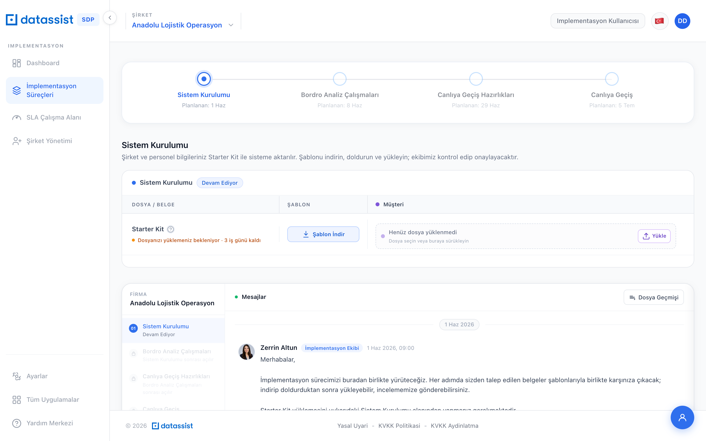 | 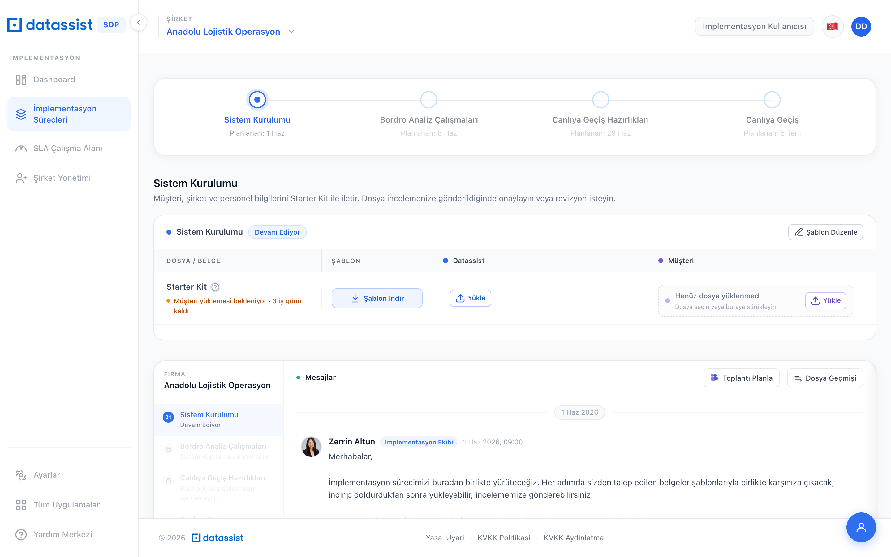 |

1.4 **Aşama açıklamaları – genel kural:** Gerçek yapıya göre yazılır; şablon sütunu yoksa "şablon" geçmez, ekranda karşılığı olmayan aksiyon anlatılmaz. Müşteri/operasyon için ayrı metin.

1.5 **Sistem Kurulumu**
- Müşteri: "Şirket ve personel bilgileriniz Starter Kit ile sisteme aktarılır. Şablonu indirin, doldurun ve yükleyin; ekibimiz kontrol edip onaylayacaktır."
- Operasyon: "Müşteri, şirket ve personel bilgilerini Starter Kit ile iletir. Dosya incelemenize gönderildiğinde onaylayın veya revizyon isteyin." (Açıklama her durumda doğru kalacak şekilde nötr yazılır; "bekleniyor" bilgisi satır durumunda verilir.)

1.6 **Bordro Analiz Çalışmaları** (şablon ve onaya gönder butonu yokken metin bunları anlatıyor)
- Müşteri: "Mevcut bordro sisteminizden son kapanan aya ait aşağıdaki çıktıları yükleyin. Şablon gerekmez; kendi sisteminizdeki formatıyla yükleyebilirsiniz."
- Operasyon: "Müşteri, mevcut bordro sisteminden alınan çıktıları yükler. Belgeler incelemenize gönderildiğinde onaylayın veya revizyon isteyin."

| Müşteri | Uzman |
|---|---|
| 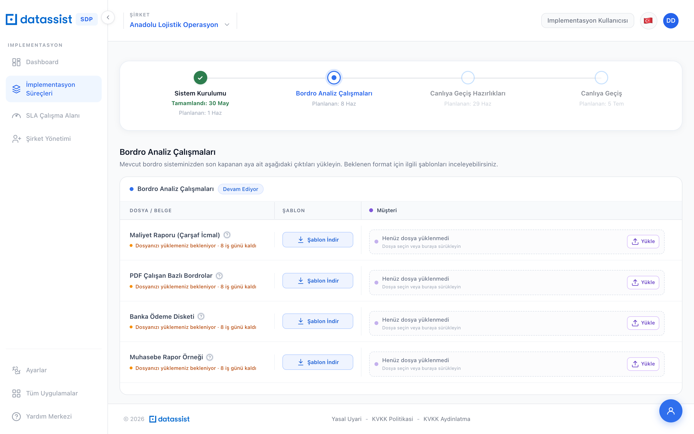 | 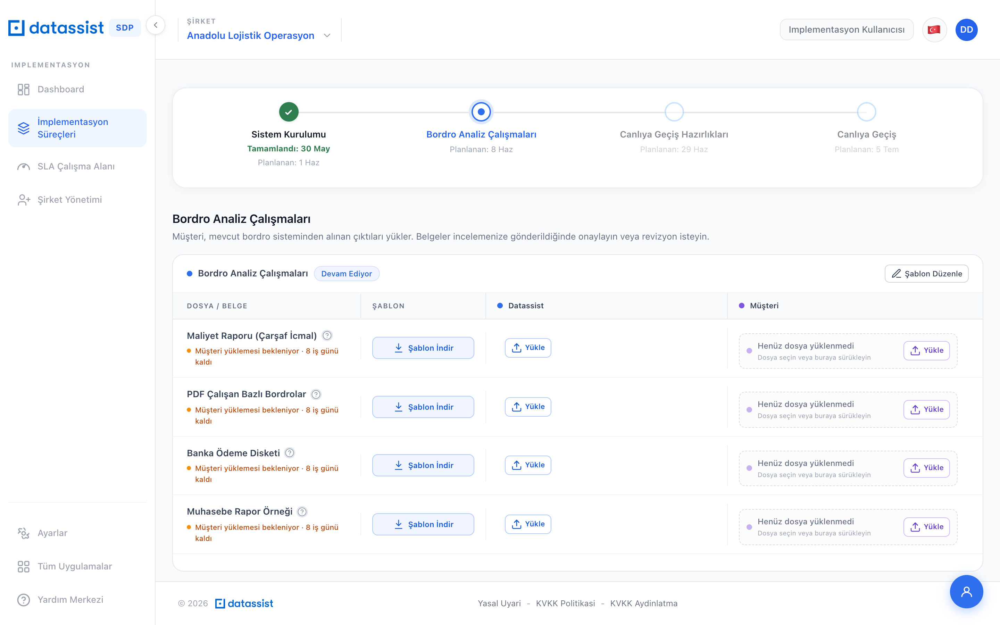 |

1.7 **Live Hazırlıkları**
- Ad: "Canlıya Geçiş Hazırlıkları" (stepper, sol liste, başlık).
- Müşteri: "Canlıya geçiş öncesi güncel bilgilerinizi paylaşın. Değişiklik olmayan maddeler için ilgili seçeneği işaretlemeniz yeterlidir."
- Operasyon: "Müşteri, canlıya geçiş öncesi güncel bilgilerini paylaşır. Yanıtlar incelemenize gönderildiğinde onaylayın veya revizyon isteyin."
- Satırlar tipine göre 1.2/1.3 metnini kullanır (Şirket Logosu → İsteğe bağlı).

| Müşteri | Uzman |
|---|---|
| 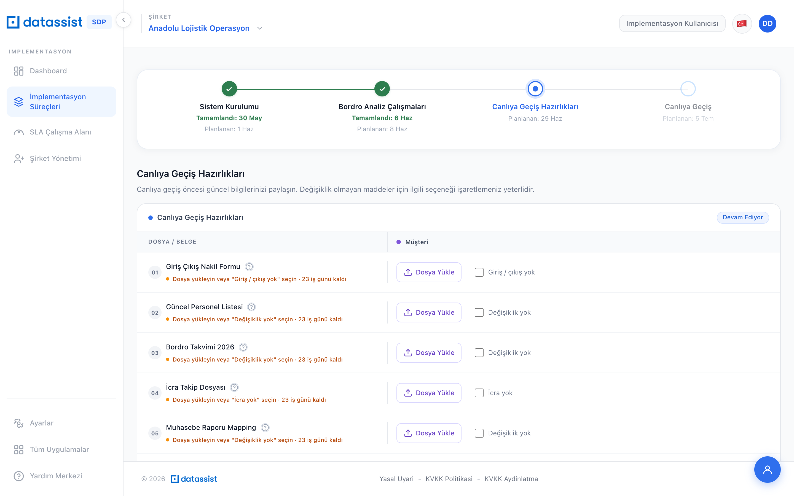 | 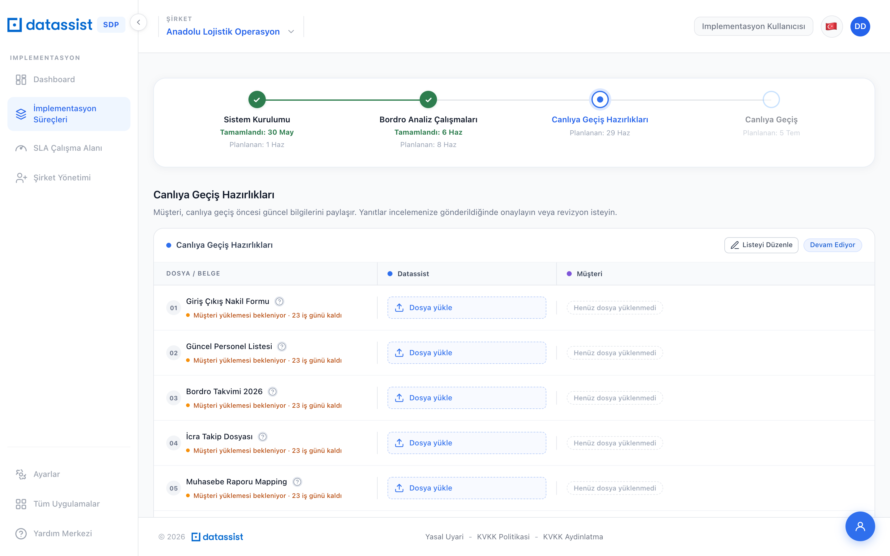 |

1.8 **Canlıya Geçiş – müşteri:** Görev listesi/sayaçlar gizlenir; kart: "**Bu aşamada sizden bir işlem beklenmiyor.** Ekibimiz firmanızı canlı ortama aktarıyor; tamamlandığında size bildirim gönderilecek." Operasyon akışı (Firmayı Kopyala) aynen kalır.

*Müşteri*

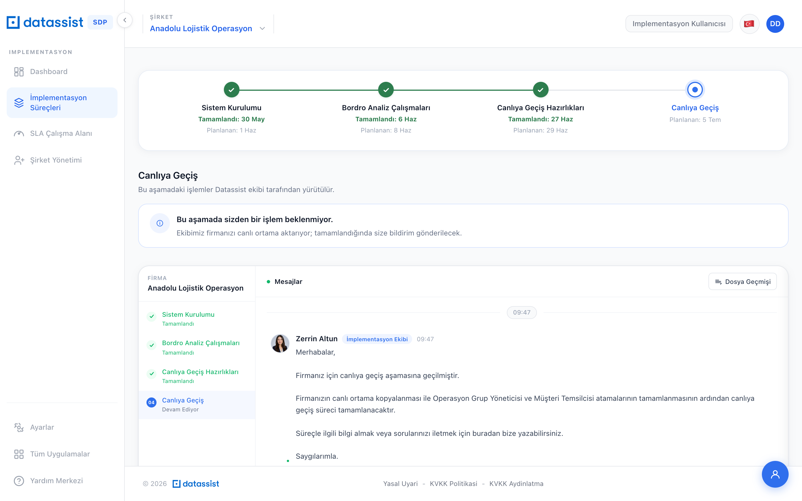

1.9 **Durum tutarlılığı:** Aktif aşama üst rozet ve sol listede "Devam Ediyor"; "Bekliyor" yalnızca başlamamış aşamalar.

1.10 **Kilitli aşamalar:** Salt önizleme, butonlar pasif, üstte "Bu aşama, [önceki aşama] tamamlandığında açılacak."

*Sol liste — kilitli aşamalar*

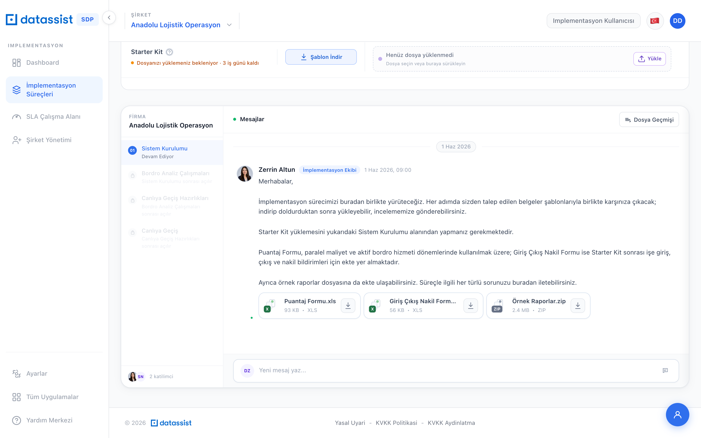

1.11 **Sol liste numaralandırma:** 01,02,05,06 atlaması → görünen aşamalar sıralı numaralanır.

1.12 **Stepper:** Aktif aşama belirgin; altında "Planlanan: Haz 01". Tarih yoksa müşteride satır gizli, operasyonda "Planlanan tarih girilmedi".

1.13 **"Zorunlu görev: 0 / 1 onaylandı":** Müşteride `1 belgeden 0'ı tamamlandı`; operasyonda aynen.

> Prototipte "Zorunlu görev" rozeti bulunmadığından görüntü yok; madde canlıya özeldir.

---

## Bölüm 2 — Starter Kit validasyon modalı – müşteri (hatalı dosya)

2.1 **Hata/uyarı anlamı:** Üst bilgi alanı:
- Hata: Düzeltilmesi zorunludur. Hatalar giderilmeden dosya gönderilemez.
- Uyarı: Gönderimi engellemez. Bilgilerin doğruluğu açısından dikkatle kontrol edilmesi gerekmektedir.
Sekmelerde tooltip.

2.2 **Sıralama:** Önce hatalar, sonra uyarılar; grup içi Starter Kit sütun sırası. Modal açılınca ilk hata seçili. "Tümü" sekmesinde de aynı kural.
Örnek: Doğum Tarihi (M, Hata) → Öğrenim Durumu (P) → SGK Sicil No (R) → Kıdem Tarihi (AH) → Maaş (AU) → IBAN (BD).

2.3 **Müşteri modalında yalnızca iki kategori: Hata (kırmızı) ve Uyarı (mor)** — canlıdaki gibi. Sekmeler: `Tümü · Hata · Uyarı`.
- Otomatik güncellemeler ve yeni eklenen alanlar müşteriye ayrı kategori olarak listelenmez; uzman modalında gösterilir (Bölüm 6). Müşteriye yalnızca alt bilgide "Dosya, otomatik düzeltmeler uygulanmış haliyle yüklenecektir." bilgisi verilir (3.6).
- Uyarı rengi müşteri modalında **mor** (nokta, sekme, kart ve etiket). Uzman modalında ve kart durumlarında amber kalır; Yeni Eklenen Alan yalnızca uzman modalında olduğu için renkler çakışmaz.
- Salt okunur müşteri modalı ("Validasyon Sonuçlarını Gör") aynı kuralı izler.

2.4 **Değer gösterimi:** Hata/uyarı değeri üstü çizilmeden; boş → `Boş`. (Otomatik düzeltme `5510 → 0000` biçimi uzman modalında kullanılır.)

2.5 **Mesaj metinleri:** Hata ve uyarı mesajlarının içeriği ayrı rapora taşındı: "Validasyon UX Düzenlemeleri – Hata ve Uyarı Mesajları" (V.1–V.3).

2.6 **Tekrarlayan uyarılar gruplanır:** Tek açıklama + `Satır · Çalışan · Değer` tablosu.

2.7 **Alt bilgi ve buton:**
- Hata varsa: "4 hata giderilmeden dosya gönderilemez. Hataların Excel dosyasında düzeltilip dosyanın yeniden yüklenmesi gerekmektedir. Ayrıca 104 uyarının kontrol edilmesi önerilir."
- Sadece uyarı: "Dosya yüklenebilir. 104 uyarının kontrol edilmesi önerilir."
- Buton adı **"Yüklemeyi Tamamla"**; pasifken tooltip "Hatalar giderilmeden yüklenemez."

2.8 **Düzenlenmiş Exceli İndir** tooltip: "Otomatik düzeltmelerin uygulandığı ve hata/uyarı hücrelerinin renklendirildiği dosyadır. Düzeltmelerin bu dosya üzerinden yapılması önerilir."

*Müşteri — hatalı dosya*

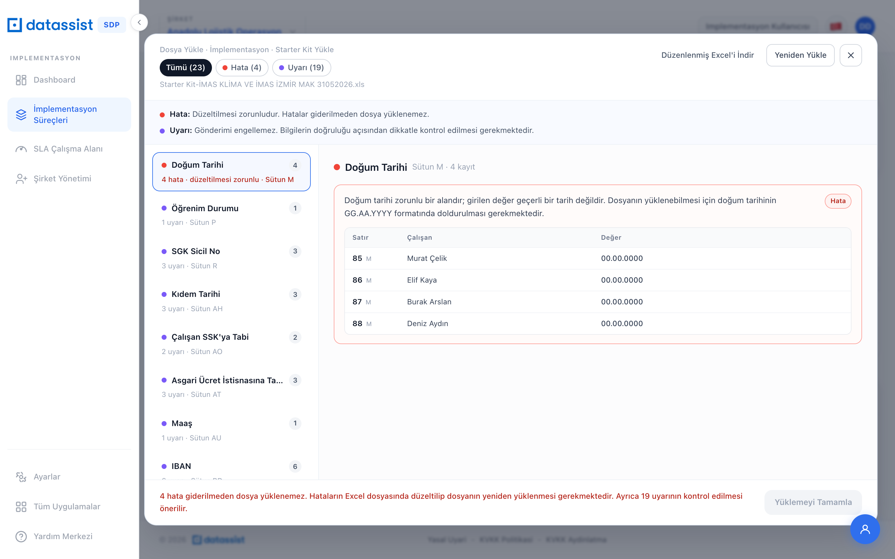

---

## Bölüm 3 — Validasyon modalı – müşteri (hatasız dosya)

3.1 **Üst bilgi duruma göre:**
- Hata yok, uyarı var: "**Dosyada yüklemeyi engelleyen bir hata bulunmamaktadır.** 19 uyarı aşağıda listelenmiştir; dikkatle kontrol edilmesi önerilir."
- Hata ve uyarı yok: "**Tüm veriler doğrulandı.**" + boş durum ekranı ("Starter Kit dosyasında hata veya uyarı tespit edilmedi.").

3.2 **Hata (0) sekmesi** yerine yeşil "✓ Hata yok" rozeti (tıklanamaz).

3.3 **Sıralama ve varsayılan seçim:** 2.2 kuralı; ilk eleman seçili.

3.4 **Buton hiyerarşisi:** Ana aksiyon "Yüklemeyi Tamamla"; "Yeniden Yükle" ve "Düzenlenmiş Exceli İndir" ikincil.

3.5 **Alt bilgi:** "Dosya yüklenmeye hazırdır. 104 uyarının kontrol edilmesi önerilir. Yükleme sonrası dosyanın incelemeye iletilmesi için 'Onaya Gönder' adımının tamamlanması gerekmektedir."

3.6 **Gönderilen dosya:** Otomatik düzeltme varsa "Dosya, otomatik düzeltmeler uygulanmış haliyle yüklenecektir." (Servis tarafında hangi dosyanın gönderildiği netleşmeli.)

| Hata yok, uyarı var | Hiç bulgu yok |
|---|---|
| 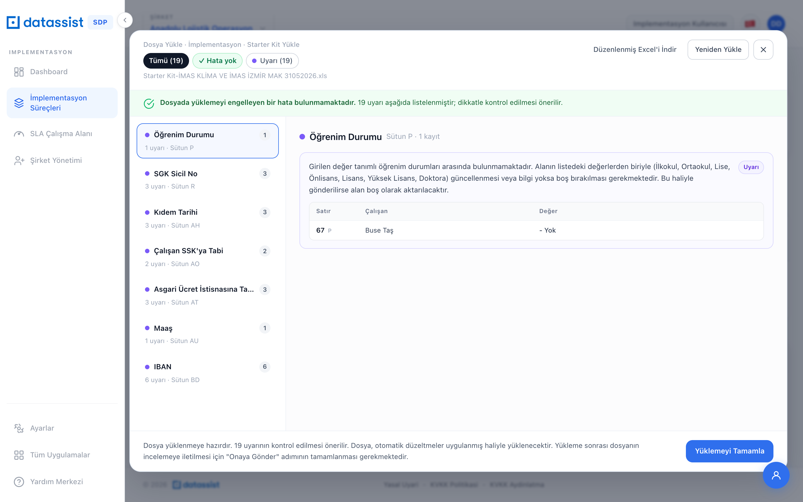 | 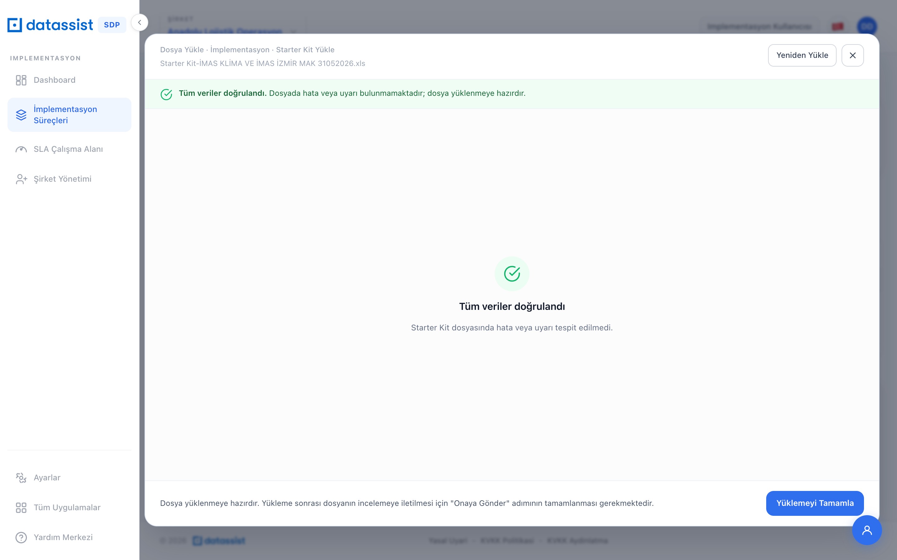 |

---

## Bölüm 4 — Onaya gönderme (müşteri)

4.1 **İki adımlı akış:** Rozet "Yanıt Hazır" → "Gönderime Hazır". Alt satır: "1 belge yüklendi. Belgelerin Datassist incelemesine iletilmesi için onaya gönderilmesi gerekmektedir." Satır: `Yüklendi · Onaya gönderilmedi` (mavi).

*Müşteri*

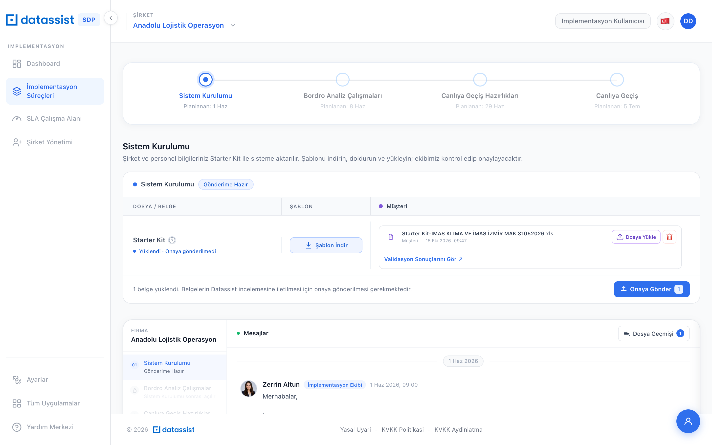

4.2 **Onay penceresi:** Başlık "Belgeler incelemeye gönderilsin mi?"; alt metin "1 belge Datassist ekibinin incelemesine iletilecektir. İnceleme tamamlanana kadar belgede değişiklik yapılamaz."; belge kartında validasyon özeti (`104 uyarı`).

*Müşteri — onay penceresi*

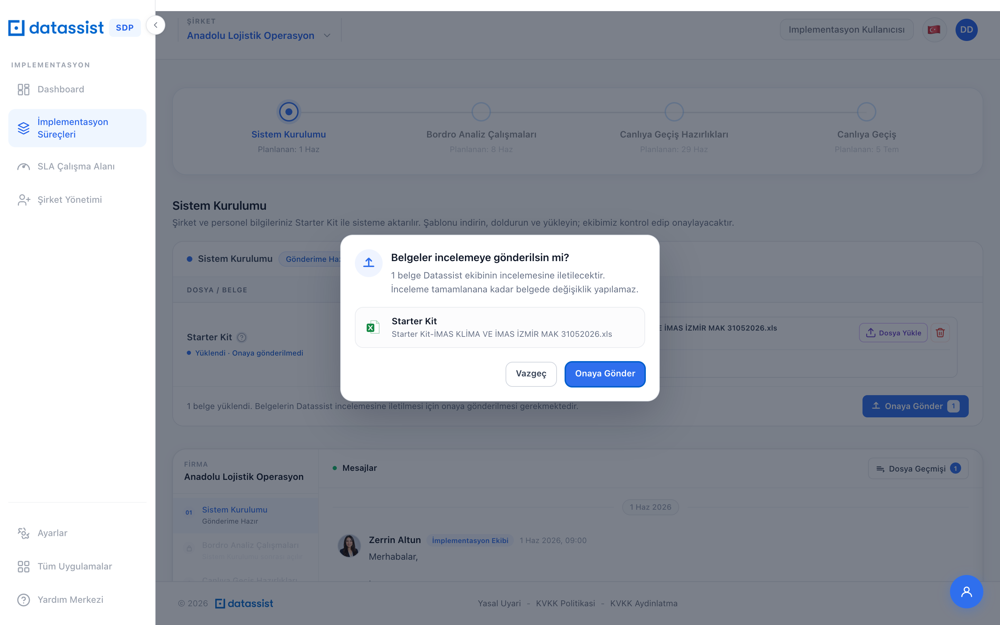

4.3 **Gönderim sonrası:** Rozet "İncelemede" (mavi); satır `Datassist ekibi tarafından inceleniyor` (gönderim zamanı dosya kartında; bkz. 4.4); toast "Starter Kit incelemeye gönderildi."; sol liste "İncelemede". (Mesajlar alanına sistem mesajı düşmez — bildirim ile verilecek.)

*Müşteri — gönderim sonrası (toast görünür)*

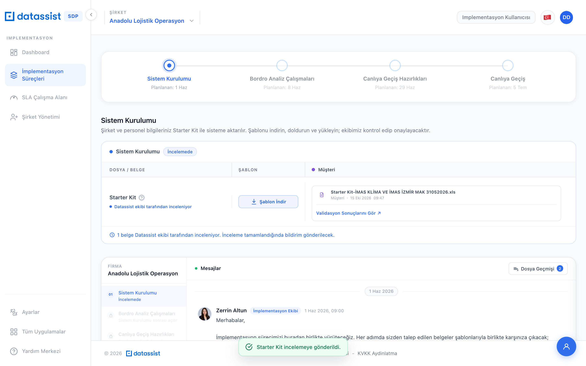

4.4 **İncelemede durumu – tutarlılık (müşteri):**
- Kart çerçevesi amber yerine açık mavi (rozet "İncelemede" mavi olduğu için; bkz. 8.4'teki tek renk kuralı).
- Satır metni yalnızca `Datassist ekibi tarafından inceleniyor` olur; "· Gönderim: 15 Eki 2026 08:50" kısmı kaldırılır. Dar sütunda iki satıra taşıyor ve gönderim zamanı dosya kartında zaten yazıyor.
- Alt bilgi: "1 belge Datassist ekibi tarafından inceleniyor. İnceleme tamamlandığında bildirim gönderilecek."
- Sağdaki "✓ Gönderildi" ibaresi kaldırılır (rozetle aynı bilgiyi tekrarlıyor).

*Müşteri — İncelemede*

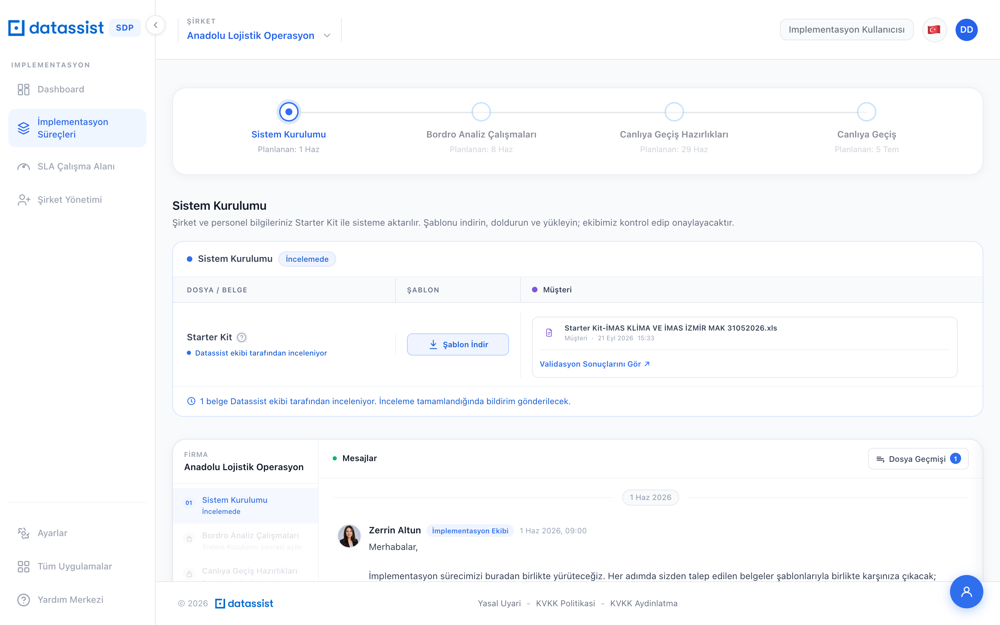

---

## Bölüm 5 — Uzman ekranı (inceleme bekleyen belge)

5.1 Alt satır: "1 belge incelemenizi bekliyor · 2 gündür bekliyor". Rozet "İnceleme Bekliyor" (amber).

5.2 **Dosya kartında validasyon çipleri gösterilmez (müşteri ve uzman, tüm durumlarda):** `19 uyarı · 13 otomatik güncelleme · 2 yeni alan` gibi çipler kartı kalabalıklaştırıyor ve uzman tablosunda kartı aşağı doğru uzatıyor. Kartta yalnızca dosya adı, tarih ve "Validasyon Sonuçlarını Gör ↗" linki (revize durumunda yanında "Red Nedenini Gör ↗") kalır; sayılar modalın içindeki kategori kartlarında görülür.

5.3 `Kararları Gönder (0/1)` sayaçlı; alt satırda "Kararlar gönderilene kadar müşteriye iletilmez."

*Uzman — inceleme bekleyen belge*

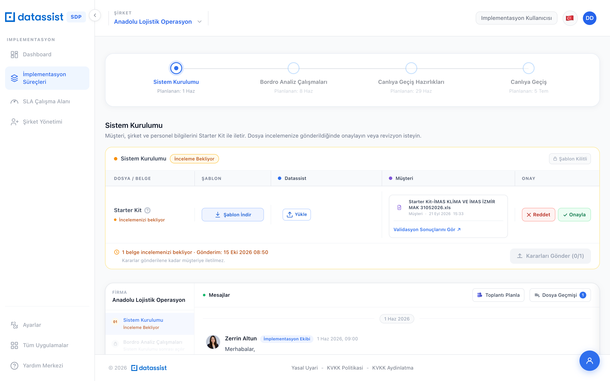

---

## Bölüm 6 — Uzman validasyon modalı

6.1 Müşteri ve uzman modalı **aynı validasyon sonucunu** kullanır; hata ve uyarı sayıları iki tarafta eşleşmelidir (şu an 104 vs 99 uyarı, farklı alanlar — servis tarafında nedeni incelenmeli). Kategori yapısı ise bilinçli olarak farklıdır: müşteri yalnızca Hata/Uyarı görür (2.3), uzman Uyarı/Otomatik Güncelleme/Yeni Eklenen Alan kategorilerinin tamamını görür.

6.2 **Öneri/uygulanmadı çelişkisi (Kıdem Tarihi):** Mesaj ve değer gösterimi "Validasyon UX Düzenlemeleri" raporunda (V.3.3).

6.3 **Uyarı kayıtları:** Değişmeyen değerin üstü çizilmez. Alan adı "Çalışan SSK'ya Tabi". (SSK ve Asgari Ücret mesaj metinleri "Validasyon UX Düzenlemeleri" raporunda, V.3.2.)

6.4 **Otomatik güncellemeler gruplanır:** Alan bazında `Mevcut | Uygulanan | Kayıt` dönüşüm tablosu; satırlar açılınca görünür.

6.5 **Kod eşleştirmeleri listelenmez:** Brüt→Brut, Aylık→Ay, Tam Zamanlı→Tam Zamanli, E→Male gibi anlamı değiştirmeyen eşleştirmeler arka planda uygulanır, listede yer almaz. Değerler kullanıcı etiketiyle gösterilir (Erkek, İndirime tabi değil). Servis: Türkçe karakter kaybı kontrol edilmeli.

6.6 **Sıfır kategori:** Pasif/gri kart, tıklanamaz; Yeni Eklenenler mor; tek ve ortalanmış boş durum.

6.7 **Bilgi metni:** "Otomatik güncellemeler dosyaya uygulanmıştır. Uyarılardaki öneriler uygulanmamıştır; müşteriyle teyit edilmesi önerilir." Modal alt kısmına **Reddet / Onayla**; "Raporu İndir" ikincil.

6.8 Kartlarda çalışan adı + sütun harfi; Starter Kit sütun sırası.

*Uzman — validasyon modalı*

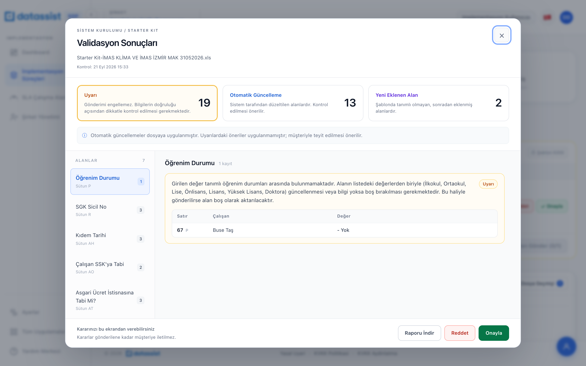

---

## Bölüm 7 — Validasyon raporu (Excel)

7.1 Sayfalar: Özet · Uyarılar · Otomatik Güncellemeler · Yeni Eklenen Alanlar (varsa).
7.2 Çalışan sütunu doldurulmalı; Sütun = Excel harfi, Alan ayrı sütun; sistem kodları yerine etiket; GSM `+90 534 543 34 35`; kod eşleştirmeleri yer almaz.
7.3 .xlsx; başlık kalın/renkli/sabit/filtreli; otomatik sütun genişliği.

> Excel raporu için ekran görüntüsü yok; prototipte "Raporu İndir" ile dosya olarak indirilir.

---

## Bölüm 8 — Red durumu (müşteri)

8.1 **Red nedeni görünür olmalı:** Reddedilen dosya kartında red nedeni yalnızca ⓘ ikonunun arkasında kaldığı için müşteri nedeni bulamıyor. Validasyon özetinde "Validasyon Sonuçlarını Gör" linkinin yanına **"Red Nedenini Gör ↗"** linki eklenir (koyu amber, kalın; bkz. 8.4). Tıklanınca Revize Talebi modalı açılır, footer'da Dosya Yükle bulunur. Link eklendiği için Starter Kit kartındaki ⓘ ikonu kaldırılır.

*Müşteri — revize kartı*

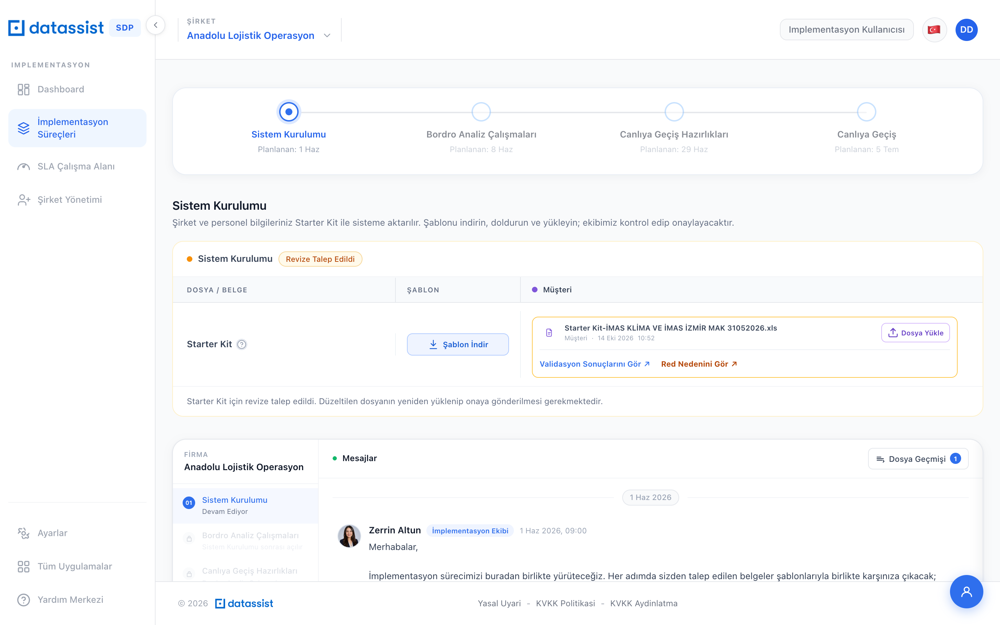

8.2 **Red modalı kendiliğinden açılır:** Müşteri reddedilen dosyayı ilk gördüğünde (ekrana ilk girişte) Revize Talebi modalı otomatik açılır.
- Her red için bir kez açılır. Kapatıldıktan sonra "Red Nedenini Gör" ile tekrar açılabilir.
- Yeni bir red gelirse yine açılır.
- Operasyon (uzman) görünümünde otomatik açılmaz.
- Canlıda modalın görüldüğü bilgisi kullanıcı bazında saklanmalıdır. Prototipte bu bilgi oturum boyunca tutuluyor.

8.3 **Red modalı içeriği:** Mevcut "İnceleme Notu / Gelen ileti" başlığı ve "Konu: Starter Kit · İnceleme sonucu" satırı sonucun red olduğunu anlatmıyor.
- Başlık: amber ikonla (kart rozetiyle aynı renk) **"Revize Talebi"**. Alt satır "Sistem Kurulumu · Starter Kit" (aşama · belge).
- "Konu" satırı kaldırılır.
- Üstte sade bir bilgi cümlesi yer alır (renkli kutu yok):
  - Müşteri: "**Starter Kit dosyanız onaylanmadı.** Aşağıdaki nota göre düzeltilen dosyanın yeniden yüklenmesi gerekmektedir."
  - Operasyon: "**Starter Kit dosyası onaylanmadı.** Müşterinin aşağıdaki nota göre düzeltilen dosyayı yeniden yüklemesi bekleniyor."
- Uzman, tarih, ekler ve not alanı aynen kalır. Footer: Dosya Yükle (ana), Kapat (ikincil).

*Müşteri — Revize Talebi modalı (8.2: ilk girişte kendiliğinden açılır)*

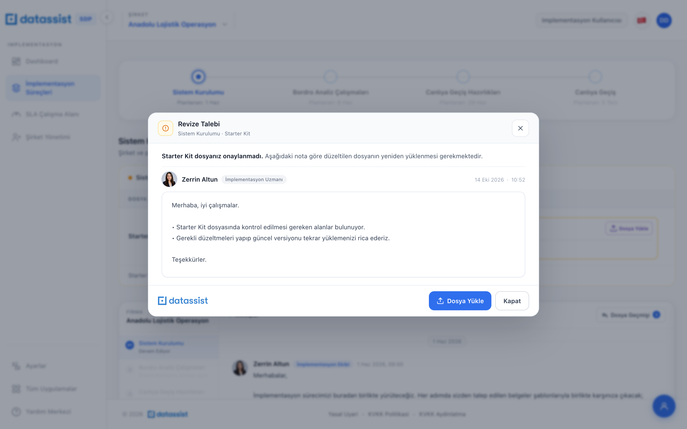

8.4 **Revize durumu renkleri:** Revize talebi bir hata değil, müşteriden beklenen bir aksiyondur. Bu yüzden her yerde tek renk (amber) kullanılır. Kırmızı yalnızca gerçek hatalara ayrılır (validasyonda gönderimi engelleyen hatalar).
- Kart başlığındaki durum noktası kırmızıdan ambere döner (rozetle aynı).
- Dış kart çerçevesi kırmızımsı yerine açık amber olur.
- Reddedilen dosya kartında pembe dolgu kaldırılır; beyaz zemin ve amber çerçeve kullanılır.
- "Red Nedenini Gör" linki koyu amber ve kalın olur.

8.5 **Revize durumu alt bilgi metni:** "1 revize veya yeni alanın yanıtlanması gerekiyor. Tüm gerekli yanıtlar tamamlanmadan Onaya Gönder aktif olmaz." metninin yerine:
| Durum | Müşteri | Operasyon |
|---|---|---|
| Dosya bekleniyor | Starter Kit için revize talep edildi. Düzeltilen dosyanın yeniden yüklenip onaya gönderilmesi gerekmektedir. (Birden fazla belgede: "3 belge için revize talep edildi. Düzeltilen dosyaların…") | Revize talep edildi · Müşterinin düzeltilen dosyayı yeniden yüklemesi bekleniyor. |
| Dosya yüklendi | Düzeltilen dosya yüklendi. Yeniden incelemeye iletilmesi için onaya gönderilmesi gerekmektedir. | Müşteri düzeltilen dosyayı yükledi; onaya gönderilmesi bekleniyor. |

*Uzman — revize durumu*

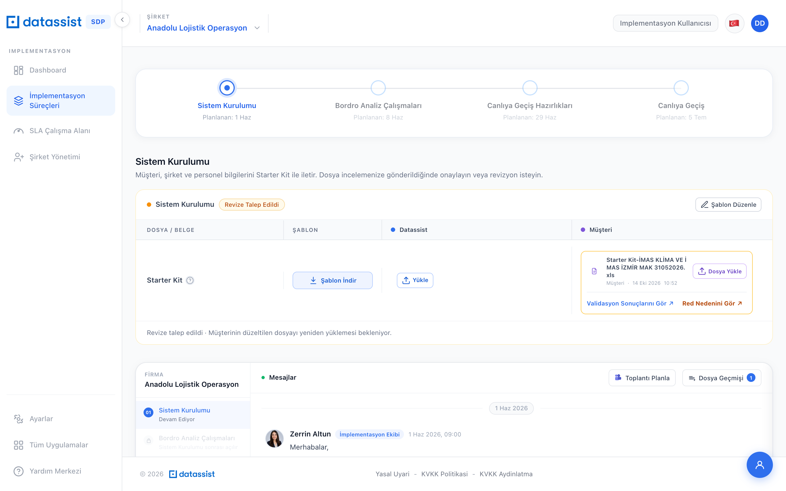

## Bölüm 9 — Onay durumu

9.1 **"Stage"/"Completed" gibi İngilizce ifadeler kullanılmaz; alt bilgi metni:** "Belgeler onaylandı. Stage tamamlanmayı bekliyor." yerine:
- Müşteri: "Starter Kit onaylandı. Sistem Kurulumu tamamlandığında Bordro Analiz Çalışmaları aşaması açılacak ve size bildirim gönderilecek." (Birden fazla belgede "Belgeleriniz onaylandı."; son aşamada sonraki aşama adı geçmez.)
- Operasyon: "Tüm belgeler onaylandı. Bir sonraki aşamanın açılması için aşamanın tamamlanması gerekmektedir."
- "Stage Tamamla" butonu → **"Aşamayı Tamamla"**; "Stage tamamlandı…" → "Aşama tamamlandı. Bu alan artık yalnızca görüntülenebilir."
- Stepper'da tamamlanan aşamanın altındaki "Completed: May 30" → "Tamamlandı: 30 May".

9.2 **Satır durumu:** Onay sonrası belge satırındaki durum boş kalmaz; yeşil `Onaylandı · 15 Eki 08:51`. (Uzman kararı gönderilmeden önce gösterilmez.)

9.3 **Dosya kartındaki ✓ ikonu kaldırılır:** Yeşil kart ve "Onaylandı" rozeti aynı bilgiyi veriyor; kartta yalnızca geçmiş ikonu kalır.

9.4 **Validasyon çipleri:** Onaylanmış dosya kartında da çip gösterilmez (bkz. 5.2); yalnızca "Validasyon Sonuçlarını Gör ↗" linki kalır.

9.5 **Rozet ve sol liste:** Kart rozeti ve sol liste "Onaylandı" gösterir (sol liste diğer durumlarda olduğu gibi kart rozetiyle aynıdır; bkz. 4.3). Stepper'da aşama tamamlanana kadar aktif aşama olarak kalır; "Tamamlandı" yalnızca aşama tamamlandığında gösterilir.

| Müşteri | Uzman |
|---|---|
| 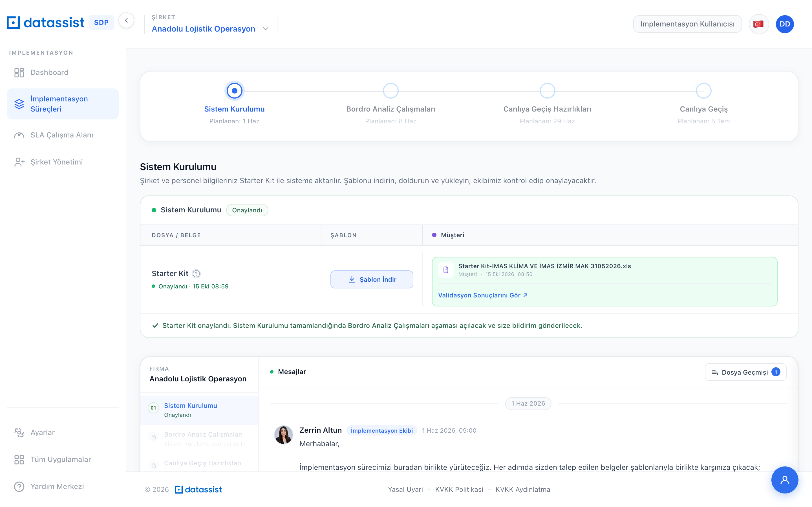 | 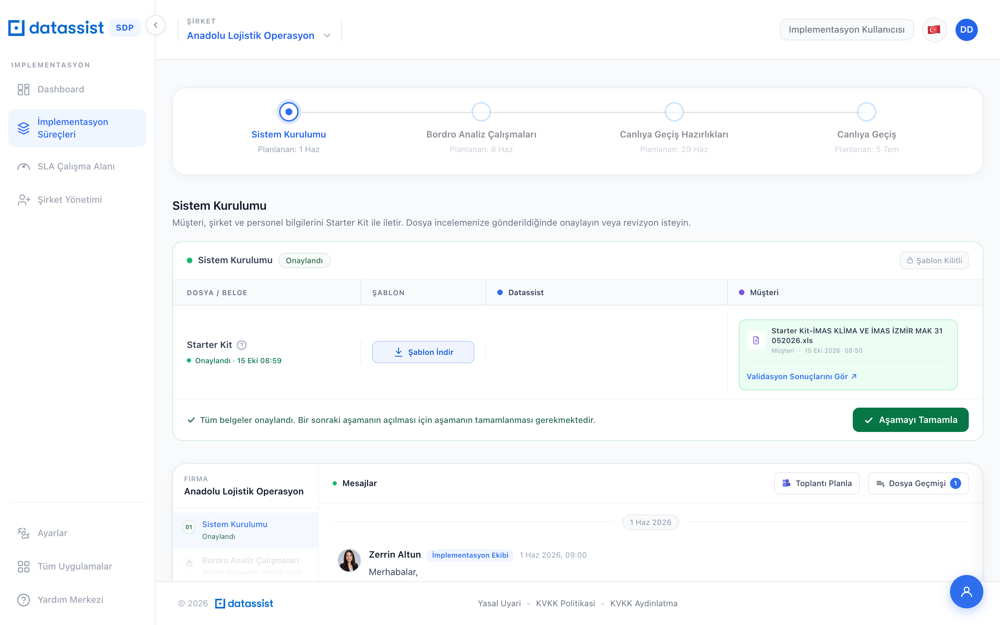 |

---

## Prototip durumu (15 Eki 2026)

Bölüm 1–9 prototipte (`legacy.html` + `app.js` + `styles.css`) uygulandı. İstisnalar:
- 1.10: Prototipte kilitli aşamalar zaten açılamıyor; sol listede ve tooltip'te "… tamamlandığında açılacak" bilgisi eklendi.
- 1.13: Prototipte "Zorunlu görev" rozeti bulunmadığı için eklenmedi (canlı için madde geçerli).
- 3.7 (uyarılı gönderim onayı) ayrı pencere yerine 4.2'deki onay penceresine uyarı sayısı eklenerek karşılandı.
- 7.3: Başlık sabitleme (`!views`) kullanılan Excel kütüphanesinde desteklenmeyebilir; filtre ve otomatik genişlik çalışıyor.
- 8.2: "Görüldü" bilgisi prototipte oturum boyunca tutuluyor; canlıda kullanıcı bazında saklanmalı.
- Kalan süre prototipte sabit demo tarihine (27 May 2026) göre hesaplanıyor; canlıda bugünün tarihi kullanılmalı.

Ek davranışlar:
- Müşteri "Validasyon Sonuçlarını Gör" ile uzman modalını değil, yükleme sırasında gördüğü modalı salt okunur açar (son yüklenen dosyanın kayıtlı sonucu, "Kapat" butonu).
- Uzman inceleme tablosunda (Onay sütunu varken) Şablon sütunu 180px; "Şablon İndir" butonu Datassist sütununa taşmaz.
- Uzman, müşteri belgesi incelemedeyken de Datassist dosyası yükleyip silebilir (Datassist dosyası müşteri yanıtının parçası değil). **Netleşmesi gereken:** Canlı için Jira'ya eklenip eklenmeyeceği.

Prototipte durumları görmek için:
- `legacy.html?page=processes&demo=rejected` → müşteri, Starter Kit revize talep edilmiş (red modalı açılır).
- `legacy.html?page=processes&validationPreview=1` → uzman, Starter Kit inceleme bekliyor (Onayla → Kararları Gönder ile onay durumu; sağ alttan rol "Düzenleyici" ile müşteri görünümü).

## Sıradaki
- Tek toplu Jira raporu (canlı ortam değişiklikleri).
