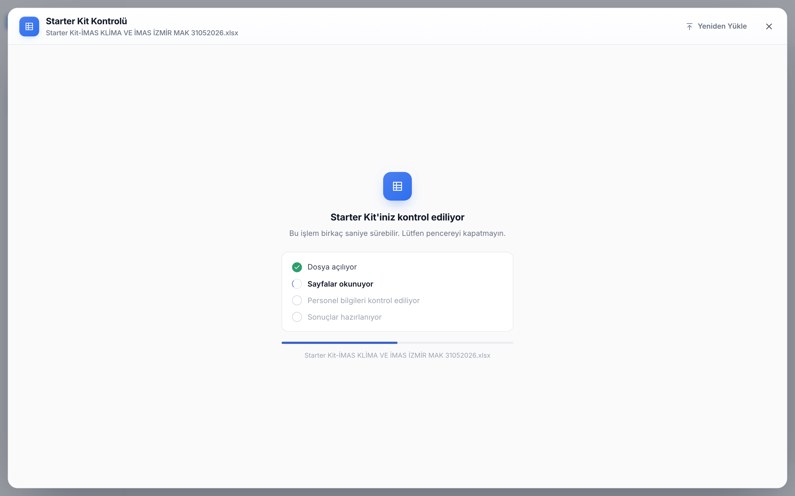
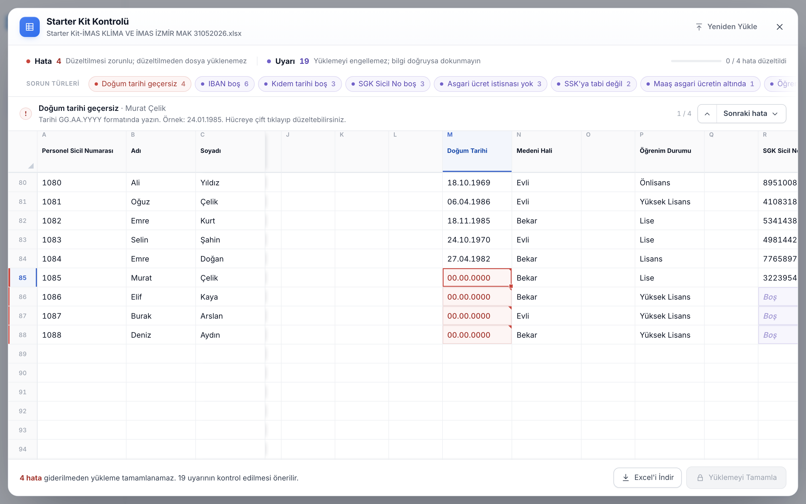
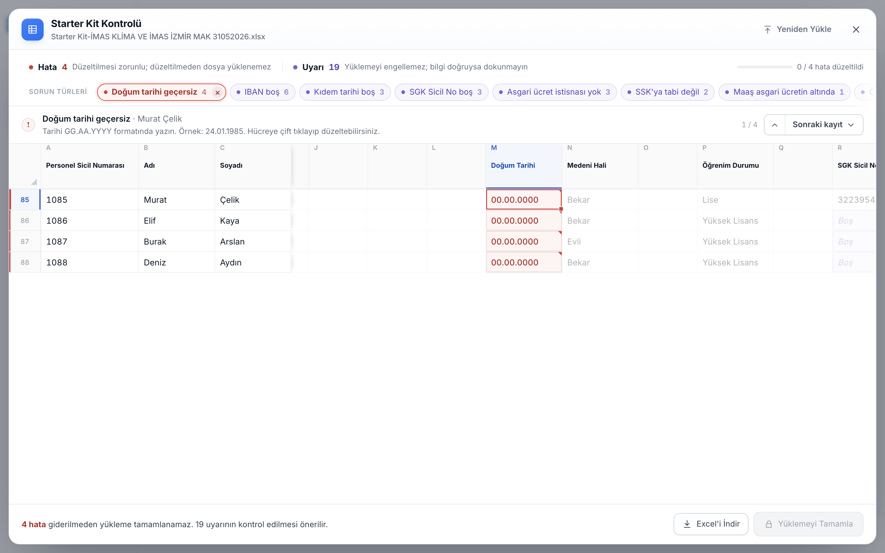
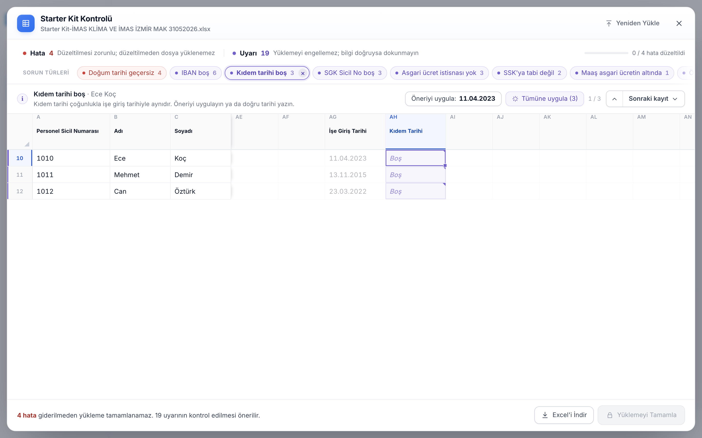
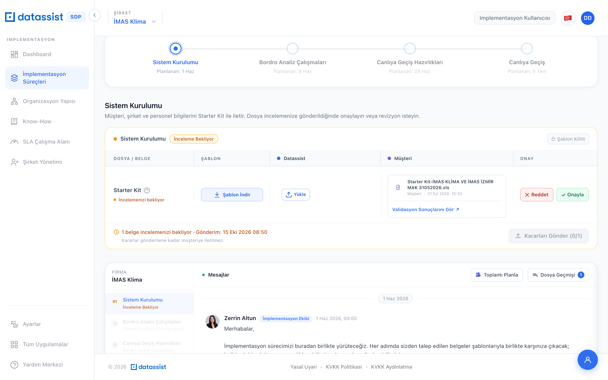
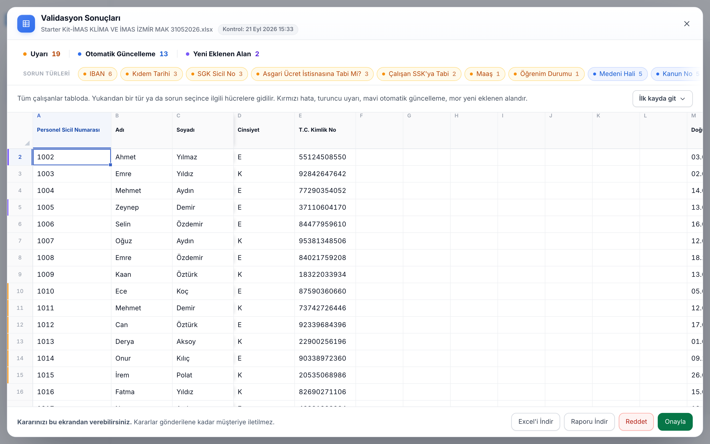
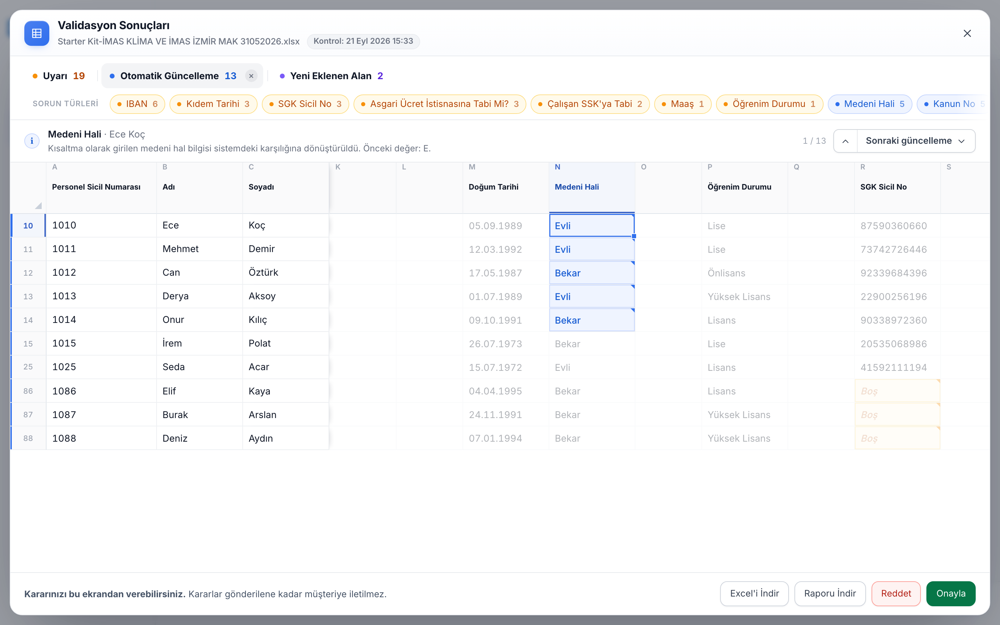
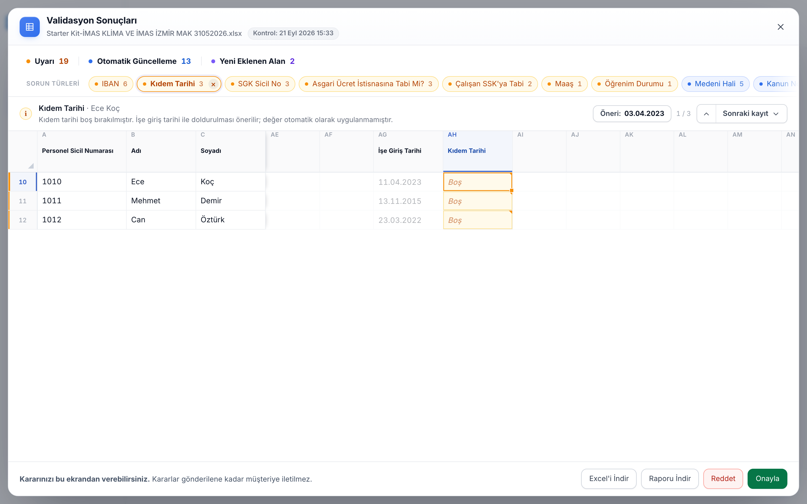
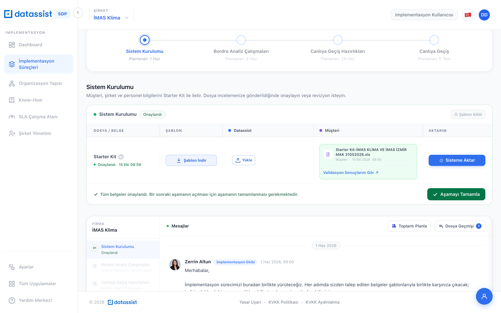

# Starter Kit – Tarayıcı İçi Excel Düzenleyici ve Uzman Excel Görünümü

| | |
|---|---|
| **Modül** | SDP › İmplementasyon › Sistem Kurulumu › Starter Kit |
| **Etkilenen repolar** | `sdp-ui`, `sdp-backend`, `implementation-service`, `implementation-validation-service` |
| **Tasarım kaynağı** | SDP-Implementasyon prototipi (`starter-kit-sheet.js`, `app.js` › `StarterKitReview`) |
| **Hazırlanma** | 24 Ekim 2026 · canlı kod `main` dalları üzerinden incelendi (sdp-ui 21 Eki, sdp-backend 23 Eki, implementation-service 21 Eki, implementation-validation-service 21 Eki) |

---

## 1. Özet

Bugün müşteri Starter Kit'i yükler, sonuçları bir kart listesinde görür. Hata varsa **düzenlenmiş Excel'i indirip kendi bilgisayarında düzeltir ve dosyayı tekrar yükler**. Uzman ise sonuçları yalnız salt okunur kartlar halinde görür. Dosyanın kendisini ekranda göremez, renkli Excel'i indiremez ve onay/red kararını ayrı bir yerden verir.

Bu işle Starter Kit **tarayıcı içinde Excel görünümüyle** açılır:

- **Müşteri** hata ve uyarıları tablo üzerinde görür, hücreyi orada düzeltir, önerileri tek tıkla uygular. Dosyayı indirip yeniden yüklemesi gerekmez. Hata kalmayınca "Yüklemeyi Tamamla" ile gönderir.
- **Uzman** "Validasyon Sonuçlarını Gör"e basınca aynı Excel görünümü salt okunur açılır. Tüm çalışanları görür; Uyarı / Otomatik Güncelleme / Yeni Eklenen Alan türleri ve sorun bazında filtreler, ilgili hücreye gider. Renkli Excel'i indirir, onay veya red kararını bu ekrandan verir.

---

## 2. Mevcut durum (canlı)

### 2.1 Müşteri akışı (CL_EDITOR)

1. Görev satırından şablonu indirir, dosyayı seçer. Dosya base64 olarak `POST /api/implementation/task-documents/validate-upload` ile gönderilir. *(sdp-ui `stage-task-panel.tsx` › `startDocumentUpload`, `runValidation`)*
2. Backend dosyayı file-storage'a koyar, `implementation-validation-service` `POST /validate` çağrılır. Sonuç `task_document_validation` tablosuna yazılır. Görev başına tek satır tutulur, her doğrulamada üzerine yazılır. *(implementation-service `TaskDocumentService.validateUpload`)*
3. `StarterKitValidationModal` açılır. **Tümü / Hata / Uyarı** filtreleri, solda alan grupları, sağda kayıt kartları (satır, çalışan, eski değer, açıklama) gösterilir. Otomatik güncelleme, yeni alan ve uzmana özel uyarılar müşteriden gizlenir (SQUAD-877).
4. Hata varsa müşteri **"Düzenlenmiş Excel'i İndir"** (`/handle/download`) ile validator'ın renklendirdiği dosyayı indirir. Dosyayı **Excel'de kendisi düzeltir** ve **yeniden yükler**. Her düzeltmede tam dosya yeniden yüklenir ve doğrulanır.
5. Hata 0 olunca "Yükle" ile `create-from-handle` çağrılır (WAITING), ardından `tasks/send` ile PENDING'e geçilir.

### 2.2 Uzman akışı (SPECIALIST / HEAD)

1. Görev satırında "Validasyon Sonuçlarını Gör" ile `StarterKitSpecialistValidationModal` açılır (SQUAD-880). Modal **tamamen salt okunurdur**: **Uyarı** (`flag_specialist`), **Otomatik Güncelleme** (`correction`) ve **Yeni Eklenenler** (`addition`) kartları, alan listesi ve kayıt kartları (`original → normalized`) gösterilir. **Hata kategorisi uzmanda yoktur.**
2. **"Raporu İndir"** tarayıcıda 4 sayfalı bir bulgu listesi üretir (Özet, Uyarılar, Otomatik Güncellemeler, Yeni Eklenen Alanlar). Bu dosya Starter Kit'in renklendirilmiş hali değildir. *(sdp-ui `validation-report-export.ts`)*
3. Renkli/düzeltilmiş dosyayı **uzman indiremez**: `/handle/download` yalnız CL_EDITOR'a açık.
4. **Onayla / Reddet** butonları modalda değil, görev satırındadır. Kararlar `/review` ile taslak olarak kaydedilir, `/tasks/send-decisions` ile yayınlanır.

### 2.3 Validasyon servisi (implementation-validation-service)

- **Doğrulanan sayfa:** Yalnız **Kişisel Bilgi** sayfası doğrulanır. Şirket Bilgi ve İşyeri Bilgi sayfaları yalnız çapraz kontrol (lookup) için okunur.
- **Kurallar:** 74 şablon kolonu ve 54 kural tanımı vardır. 99 JSON kuralı + motorun kendi kuralları seviyelere şöyle dağılır: `error` 22, `flag_user` 32, `flag_specialist` 16, `correction` 29. Bunlara normalize adımları, enum eşleştirmeleri ve tarih/zorunlu kolon kontrolleri eklenir.
- **Düzeltilmiş dosya:** Otomatik düzeltmeler dosyaya yazılır ve her hücre en ağır seviyenin rengiyle boyanır:

  | Seviye | Renk |
  |---|---|
  | error | `#F8D7DA` |
  | flag_user | `#FFF3CD` |
  | flag_specialist | `#E8DAEF` |
  | correction | `#DCEAFB` |
  | eklenen kolon başlığı | `#ABEFC6` |

  Dosyada **hücre notu ve renk açıklaması yoktur**. Müşteri ve uzman aynı dosyayı alır, bu yüzden müşteri indirmesinde uzmana özel renkler de görünür.
- **Hücre verisi dönmüyor:** Yanıt yalnız sorunlu hücreleri (`cell`, `column`, `original`, `normalized`, `level`, `description`) içerir, sayfanın tamamını döndürmez.
- **Baseline (SQUAD-965):** Düzeltmeler ilk yüklenen dosyaya göre yeniden hesaplanır.

### 2.4 Kütüphaneler (sdp-ui)

- Next.js 14.2, React 18.3, MUI v6.
- `xlsx` (SheetJS) ve `xlsx-js-style` **zaten projede var**. Tarayıcıda `XLSX.read` örneği puantaj panelinde kullanılıyor.
- Grid/spreadsheet kütüphanesi (Handsontable, AG Grid, MUI DataGrid vb.) **yok**.

### 2.5 Bugün olmayanlar

| # | Eksik |
|---|---|
| 1 | Yüklenen dosyanın tarayıcıda Excel görünümü (müşteri ve uzman) |
| 2 | Hücre bazında düzeltme; yeniden yüklemeden yeniden doğrulama |
| 3 | Düzenlenmiş veriden belge oluşturma (`create-from-handle` yalnız validator handle'ı alıyor) |
| 4 | Uzmanın tüm çalışanları görüp türe/soruna göre filtreleyip hücreye gitmesi |
| 5 | Uzmanın renkli Excel indirmesi; hücre notları ve renk açıklaması |
| 6 | Validasyon ekranından onay/red |
| 7 | `problems[]` listesinin rol bazında sunucuda süzülmesi (bugün yalnız `summary` süzülüyor) |

---

## 3. Hedeflenen davranış

### 3.1 Müşteri – Starter Kit Kontrolü (Excel düzenleyici)

**Açılış**
- Müşteri dosyayı seçince tam ekran **"Starter Kit Kontrolü"** açılır. Önce adımlı bir yükleme ekranı gelir: "Dosya açılıyor → Sayfalar okunuyor → Personel bilgileri kontrol ediliyor → Sonuçlar hazırlanıyor".
- Dosya şablona uymuyorsa (Kişisel Bilgi sayfası bulunamazsa) uyarı gösterilir, yükleme engellenir, "Yeniden Yükle" sunulur.

**Üst bölüm**
- **Hata (N)** ve **Uyarı (N)** seçimleri vardır. Tıklanınca o türün satırları süzülür ve ilk hücreye gidilir.
- "x / N hata düzeltildi" ilerleme çubuğu gösterilir.
- **Sorun türleri** çipleri (ör. "Doğum tarihi geçersiz 4", "IBAN boş 6") vardır. Bir çip seçilince tür filtresi kalkar, yalnız o sorunun hücreleri vurgulanır, diğer hücreler soluklaşır.
- **Bağlam çubuğu**, seçili hücrenin sorun başlığını, çalışan adını ve "Nasıl düzeltilir?" metnini gösterir. Bağlam çubuğunda:
  - Öneri varsa **"Öneriyi uygula: 03.04.2023"** butonu çıkar. Aynı alanda birden fazla öneri varsa **"Tümüne uygula (N)"** de çıkar.
  - "Önceki / Sonraki hata" ile kayıtlar arasında gezilir, "1 / 4" sayacı gösterilir.

**Tablo**
- Dosyanın kendisi gösterilir: sütun harfleri, TR/EN başlıklar, sayfa sekmeleri (sekmede o sayfanın sorun sayısı rozeti) ve birleşik hücreler.
- Sicil, Adı ve Soyadı sola sabittir.
- Hücre renkleri: hata kırmızı, uyarı mor. Boş sorunlu hücrede "Boş" yazar. Üzerine gelince sorun kartı açılır.
- Düzenleme: çift tıklama veya doğrudan yazma ile hücre düzenlenir. Excel'den blok kopyala/yapıştır, **Geri al / Yinele (⌘Z / ⌘⇧Z)** ve klavye ile gezinme desteklenir. Düzenlenen hücre işaretlenir, başlıkta "N hücre düzenlendi" görünür.
- Sütun genişliği başlık kenarından sürüklenir, çift tıklayınca içeriğe sığar.
- Her düzenlemeden sonra o satır yeniden doğrulanır; sayılar ve renkler anında güncellenir (bkz. §4).
- Büyük dosyada satırlar sanallaştırılarak çizilir (ör. 2.000+ çalışan).

**Alt bölüm**
- "**N hata** giderilmeden yükleme tamamlanamaz. N uyarının kontrol edilmesi önerilir." bilgisi gösterilir.
- **Excel'i İndir:** kalan hata ve uyarıların işaretli olduğu kopya indirilir.
- **Yüklemeyi Tamamla:** hata 0 olana kadar kilitlidir. Hata 0 olunca düzenlenmiş dosya belge olarak oluşturulur (WAITING). Uyarılar gönderimi engellemez.
- Kaydedilmemiş düzenleme varken pencere kapatılırsa onay istenir.

**Müşteri hangi seviyeleri görür:** `error` ve `flag_user`. `correction`, `addition` ve `flag_specialist` gösterilmez. Otomatik düzeltmeler dosyaya uygulanmış olarak gelir. (Bugünkü SQUAD-877 kuralı korunur.)

### 3.2 Uzman – Validasyon Sonuçları (Excel görünümü)

- "Validasyon Sonuçlarını Gör" doğrudan **aynı Excel bileşenini salt okunur** açar. Eski kart modalının yerini alır.
- Başlıkta "Validasyon Sonuçları", dosya adı ve **Kontrol: tarih saat** yer alır.
- **Tüm çalışanlar** tabloda görünür. Hücre düzenleme, yeniden yükleme ve öneri uygulama kapalıdır; öneriler yalnız metin olarak gösterilir.
- **Tür seçimleri:** Hata (yalnız kayıt varsa), Uyarı (`flag_specialist`), Otomatik Güncelleme (`correction`), Yeni Eklenen Alan (`addition`).
  - **Kaydı 0 olan tür gösterilmez.**
  - Seçimler tek satırda yan yana durur; açıklamalar ipucu olarak çıkar.
- **Renkler:** hata kırmızı, uyarı turuncu, otomatik güncelleme mavi, yeni alan mor.
- **Filtreleme**
  - Tür veya sorun çipi seçilince ilgili satırlar kalır ve ilk hücreye gidilir.
  - Eşleşmeyen hücreler soluklaşır. Başka türden bulgular rengini korur ama soluk görünür.
  - Sorun çipi seçilince tür filtresi otomatik kalkar.
- **Bağlam çubuğu:** Alan, çalışan ve mesaj gösterilir. Otomatik güncellemede **"Önceki değer: E"** de yazar.
- **Alt bölüm** (karar bekleyen dosyada):
  - "Kararınızı bu ekrandan verebilirsiniz" bilgisi
  - **Excel'i İndir** (renkli, bkz. §3.3)
  - **Raporu İndir** (bugünkü bulgu listesi)
  - **Reddet** ve **Onayla**: bugünkü `/review` taslak kararı ve `/send-decisions` akışı korunur. Karar verilince ekran kapanır.
  - Karar verilmiş veya beklenmeyen dosyada "Yalnızca görüntüleme" bilgisi gösterilir.

### 3.3 Renkli Excel (uzman indirmesi)

- **Dosya:** Müşterinin yüklediği son Starter Kit, satır ve sütun düzeni aynen korunarak indirilir.
- **Renkler:** Her bulgu hücresi ekrandaki renkle boyanır.
- **Hücre notu:** Her bulgu hücresinin notunda bulgunun açıklaması bulunur. Örnek: "Uyarı: IBAN alanı boş… Önerilen değer: …". Otomatik güncellemelerde önceki değer de yazar.
- **Renk Açıklaması sayfası:** Dosyanın sonuna eklenir. İçinde her rengin anlamı, kayıt sayıları, dosya adı ve kontrol tarihi yer alır.
- **Dosya adı:** `<dosya>_Validasyon_Renkli.xlsx`.

---

## 4. Teknik yaklaşım

### Seçenek A – önerilen ilk adım (backend değişikliği az)

1. **Tabloyu doldurmak:** sdp-ui yüklenen dosyayı SheetJS ile (`xlsx`, zaten mevcut) tarayıcıda okur. Validator'ın `problems[].cell` değerleri tabloya eşlenir; `parseCell` mevcut.
2. **Yeniden doğrulamak:** Müşteri düzeltme yaptıktan sonra (ör. "Kontrol et" butonu veya kısa bir bekleme sonrası) düzenlenmiş tablo tarayıcıda yeniden xlsx'e yazılır ve **mevcut `validate-upload`** ile doğrulatılır. Sonuç tabloya yeniden eşlenir. Böylece kurallar tek yerde, validator'da kalır.
3. **Göndermek:** "Yüklemeyi Tamamla", son doğrulamanın dosyasıyla mevcut `create-from-handle`'ı çağırır.
4. **Uzman görünümü:** Uzman ekranı `/download` ile belgeyi alır, SheetJS ile açar ve `/validation` sonucunu (uzman seviyeleri) tabloya eşler.
5. **Renkli Excel:** Uzmanın renkli Excel'i tarayıcıda `xlsx-js-style` ile üretilir. Böylece `/handle/download` yetkisini genişletmek gerekmez.

**Dikkat:** Her yeniden doğrulamada tam dosya yüklenir ve file-storage'a yazılır. Sık tetiklenirse maliyetli olur; tetikleme manuel ya da seyrek tutulmalı.

### Seçenek B – sonraki adım (anlık doğrulama)

- `implementation-validation-service`'e dosyasız, JSON alan bir uç eklenir (ör. `POST /validate-rows`: kolonlar + değişen satırlar → problems). Doğrulama satır bazında anlık yapılır.
- Gönderimde düzenlenmiş veri backend'de xlsx'e yazılıp belge oluşturulur (yeni bir `create-from-edits` ucu).

### Her iki seçenekte gereken backend işleri

| İş | Repo | Açıklama |
|---|---|---|
| `problems[]` rol bazında süzülsün | implementation-service | Müşteriye `flag_specialist`, `correction`, `addition` dönmesin. Bugün yalnız `summary` süzülüyor. |
| Bulgu konumu kesin olsun | implementation-validation-service | `problems[]` içinde sayfa adı ve satır/sütun indeksi açıkça dönsün. Bugün `cell` metninden çözülüyor. |
| Müşteri indirmesindeki renkler | implementation-validation-service | Müşteriye giden düzeltilmiş dosyada `flag_specialist` rengi olmasın veya müşteri ile uzman için ayrı dosya üretilsin. |
| Renk uyumu | implementation-validation-service + sdp-ui | Bkz. §6. |
| Feature flag | sdp-ui | `validationEnabled = true` sabit. Yeni düzenleyici için aç/kapa anahtarı eklensin. |

---

## 5. Kabul kriterleri

**Müşteri**

- [ ] Starter Kit seçilince Excel düzenleyici açılır. Kişisel Bilgi sayfası bulunamazsa "Şablon tanınmadı" uyarısı çıkar ve yükleme engellenir.
- [ ] Hata ve uyarı sayıları validator sonucuyla birebir aynıdır. Müşteri `correction`, `addition` ve `flag_specialist` görmez.
- [ ] Hücre düzenlenip kontrol edilince sayılar, renkler ve "x / N hata düzeltildi" güncellenir.
- [ ] "Öneriyi uygula" ve "Tümüne uygula (N)" değeri yazar; geri alma (⌘Z) çalışır.
- [ ] Excel'den çok hücreli yapıştırma çalışır.
- [ ] Hata > 0 iken "Yüklemeyi Tamamla" kilitlidir. Hata 0 olunca belge WAITING olarak oluşur ve görev satırında görünür.
- [ ] "Excel'i İndir" kalan hata ve uyarıları işaretli kopyayı indirir.
- [ ] Kaydedilmemiş değişiklikle kapatmada onay istenir.
- [ ] 2.000 satırlık dosyada kaydırma akıcıdır (sanallaştırma).

**Uzman**

- [ ] "Validasyon Sonuçlarını Gör" Excel görünümünü salt okunur açar. Hücre düzenlenemez, yükleme ve öneri butonları görünmez.
- [ ] Tüm çalışanlar görünür. Kaydı 0 olan tür görünmez. Türler tek satırda yan yana durur.
- [ ] Tür veya sorun seçilince ilgili hücreye gidilir ve diğer hücreler soluklaşır. Sorun çipi seçilince tür filtresi kalkar.
- [ ] Otomatik güncellemede önceki değer görünür.
- [ ] "Excel'i İndir" renkli dosyayı hücre notları ve Renk Açıklaması sayfasıyla indirir.
- [ ] Reddet ve Onayla mevcut taslak karar akışıyla çalışır; karar sonrası ekran kapanır ve satır durumu güncellenir.
- [ ] CL_VIEWER salt okunur görünümü görür; karar butonlarını görmez.

---

## 6. Açık sorular

1. **Renk paleti** üç yerde farklı:

   | Yer | Uyarı | Otomatik güncelleme | Yeni alan |
   |---|---|---|---|
   | Validator dosyası | flag_user sarı, flag_specialist mor | mavi | yeşil başlık |
   | Prototip müşteri ekranı | mor | – | – |
   | Prototip uzman ekranı | turuncu | mavi | mor |

   Tek palette karar verilmeli; önerimiz uzman ekranındaki palet.
2. **Yeniden doğrulama tetikleyicisi** (Seçenek A): manuel "Kontrol et" butonu mu, kısa bekleme sonrası otomatik mi?
3. **Diğer sayfalar:** Şirket ve İşyeri sayfaları da düzenlenebilir mi, yoksa yalnız Kişisel Bilgi mi? (Validator bugün yalnız Kişisel Bilgi'yi doğruluyor.)
4. **Uzman düzeltmesi:** Uzman tablo üzerinde düzeltme yapabilmeli mi, yoksa yalnız görüntüleme mi? (Prototip: yalnız görüntüleme.)
5. **CSV:** Görev ayarı CSV'ye izin veriyor ama validator CSV okuyamıyor. CSV kaldırılsın mı?

---

## 7. Kapsam dışı (ayrı iş)

- **Sisteme aktar:** Starter Kit'ten şirket, işyeri, departman ve çalışan oluşturma. Canlıda karşılığı yok; prototipte onay sonrası "Aktarım" sütununda duruyor.
- Hücre bazında müşteri–uzman yorumlaşması.
- Doğrulama geçmişi ve sürüm karşılaştırması. Bugün görev başına yalnız son sonuç tutuluyor.

---

## 8. Ekran görüntüleri (prototip)

**Müşteri – kontrol ediliyor**

**Müşteri – Excel düzenleyici (hata + uyarı)**

**Müşteri – hata seçimi ve düzeltme yönlendirmesi**

**Müşteri – uyarı ve "Öneriyi uygula"**

**Uzman – belge tablosunda inceleme bekleyen Starter Kit**

**Uzman – Excel görünümü (tüm çalışanlar)**

**Uzman – Otomatik Güncelleme filtresi**

**Uzman – sorun seçimi, diğer hücreler soluk**

**Uzman – onay sonrası (Aktarım sütunu, kapsam dışı)**

---

## 9. Referanslar (canlı kod)

| Repo | Dosya / sınıf |
|---|---|
| sdp-ui | `src/modules/implementation/components/stage-task-panel.tsx` (`StageTaskPanel`) |
| sdp-ui | `src/modules/implementation/components/starter-kit-validation-modal.tsx` |
| sdp-ui | `src/modules/implementation/components/starter-kit-specialist-validation-modal.tsx` |
| sdp-ui | `src/modules/implementation/validation-report-export.ts` |
| sdp-ui | `src/modules/implementation/contexts/implementation-context/services.ts` |
| sdp-ui | `src/modules/implementation/utils.ts` (`parseCell`, `VALIDATION_TASK_TYPES`) |
| sdp-backend | `TaskDocumentController`, `ImplementationPermissionService.checkWorkgroupPermission` |
| implementation-service | `TaskDocumentService` (`validateUpload`, `getValidation`, `createFromHandle`, `restrictSummaryToRole`) |
| implementation-service | `task_document_validation` tablosu (V6, V11) |
| implementation-validation-service | `app/api/routes.py`, `app/services/{validation,loader,engine,baseline,report}.py` |
| implementation-validation-service | `app/rulesets/personal_info.json` |
