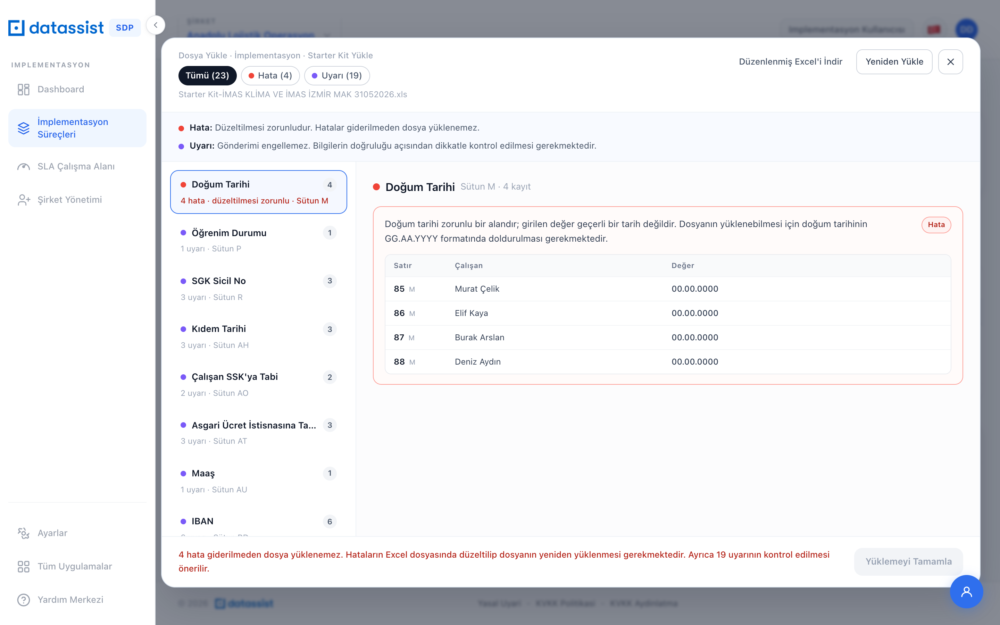
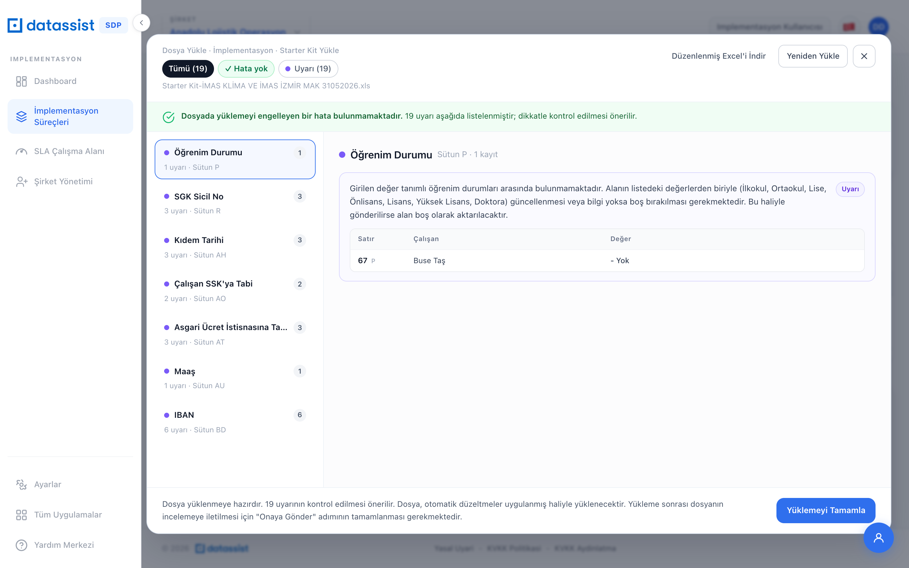
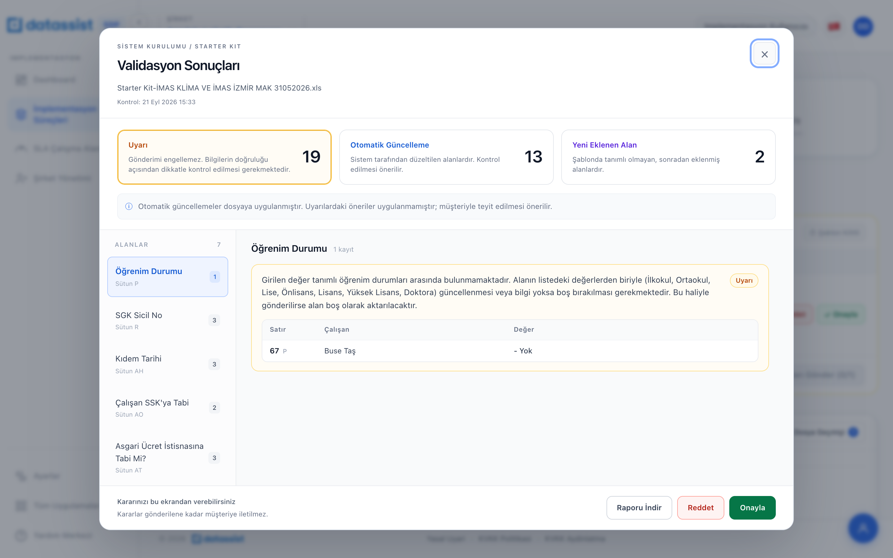

# Validasyon UX Düzenlemeleri – Hata ve Uyarı Mesajları

Starter Kit validasyonunda müşteriye ve implementasyon uzmanına gösterilen hata, uyarı ve otomatik güncelleme mesajlarının anlamlı hale getirilmesi. Mesaj metinleri validasyon servisinden gelir; bu rapordaki maddeler servis tarafında uygulanır.
Ekran tarafındaki düzenlemeler (kategoriler, renkler, sıralama, gruplama) ayrı rapordadır: "Canlı İmplementasyon Modülü – UX Bulguları".

Durum: Kesinleşti (15 Eki 2026). Ekran görüntüleri prototipten alınmıştır; mesajlar prototipte örnek olarak kullanılmaktadır.

---

## V.1 — Genel kurallar

V.1.1 **Mesaj yapısı:** Her mesaj üç bölümden oluşur:
- **Ne tespit edildi:** Alan ve girilen değer (`'00.00.0000'`, `'- Yok'`, `3.475 TL` gibi).
- **Neden sorun:** Kural veya etkisi (zorunlu alan, tanımlı değerler arasında yok, asgari ücretin altında).
- **Ne yapılmalı / sistem ne yaptı:** Hata ve uyarıda yapılması gereken; otomatik güncellemede sistemin uyguladığı değişiklik.

V.1.2 **Dil:** Emir kipi kullanılmaz; bilgilendirici dil kullanılır ("…gerekmektedir", "…önerilir"). Teknik kod veya sistem değeri yerine kullanıcı etiketi gösterilir (Erkek, İndirime tabi değil).

V.1.3 **Kim neyi görür:**
- Müşteri: yalnızca **Hata** ve **Uyarı** mesajları.
- Uzman: Uyarı, Otomatik Güncelleme ve Yeni Eklenen Alan mesajlarının tamamı.

V.1.4 **Tanınmayan değer mesajları:** Mesajda geçerli değer listesi gösterilir ve dosya bu haliyle gönderilirse alana ne olacağı açıkça yazılır (örn. "alan boş olarak aktarılacaktır").

V.1.5 **Dinamik referanslar:** Asgari ücret gibi dönemsel değerler mesaja sabit yazılmaz; güncel değer servisten dinamik eklenir.

---

## V.2 — Müşteri mesajları (Hata / Uyarı)

| Alan | Tür | Önerilen mesaj |
|---|---|---|
| Doğum Tarihi | Hata | Doğum tarihi zorunlu bir alandır; girilen '00.00.0000' değeri geçerli bir tarih değildir. Dosyanın gönderilebilmesi için doğum tarihinin GG.AA.YYYY formatında doldurulması gerekmektedir. |
| Öğrenim Durumu | Uyarı | Girilen '- Yok' değeri tanımlı öğrenim durumları arasında bulunmamaktadır. Alanın listedeki değerlerden biriyle (İlkokul, Ortaokul, Lise, Önlisans, Lisans, Yüksek Lisans, Doktora) güncellenmesi veya bilgi yoksa boş bırakılması gerekmektedir. Bu haliyle gönderilirse alan boş olarak aktarılacaktır. |
| Maaş | Uyarı | Çalışan asgari ücret istisnasına tabi olarak belirtilmiş; ancak girilen maaş (3.475 TL), güncel asgari ücretin (XX.XXX TL) altındadır. Maaş tutarının kontrol edilmesi gerekmektedir. |
| IBAN | Uyarı | IBAN alanı boş bırakılmıştır. Dosya bu haliyle gönderilebilir; ancak maaş ödemelerinin yapılabilmesi için IBAN bilgisinin canlıya geçişten önce tamamlanması gerekmektedir. |

| Hata | Uyarı |
|---|---|
|  |  |

---

## V.3 — Uzman mesajları

V.3.1 **Otomatik güncelleme mesajları:** Sistemin ne yaptığı ve nedeni yazılır.

| Alan | Önerilen mesaj |
|---|---|
| Meslek Kodu | Meslek kodu, sisteme aktarım için zorunlu bir alandır. Boş bırakıldığı için 0000.00 olarak dolduruldu. Doğru meslek kodunun girilmesi önerilir. |
| Kanun No | Çalışan emekli olarak belirtildiği için Kanun No 5510 yerine 0000 olarak güncellendi. |

V.3.2 **Uyarı mesajları:**

| Alan | Önerilen mesaj |
|---|---|
| Çalışan SSK'ya Tabi | Çalışan SSK'ya tabi değil olarak belirtilmiştir. Bu durum istisnai olduğundan bilginin müşteriyle teyit edilmesi önerilir. |
| Asgari Ücret İstisnası | Çalışan asgari ücret istisnasına tabi değil olarak belirtilmiştir. Bu bilgi bordro hesaplamasını etkileyeceğinden teyit edilmesi önerilir. |

V.3.3 **Öneri / uygulanmadı çelişkisi (Kıdem Tarihi):** Mevcut durumda aynı kayıtta "İşe Giriş Tarihi'nden alındı" ve "Değer değiştirilmedi" birlikte görünüyor; değerin uygulanıp uygulanmadığı anlaşılmıyor.
- Mesaj: "Kıdem tarihi boş bırakılmıştır. İşe giriş tarihi (03.04.2023) ile doldurulması önerilir; değer otomatik olarak uygulanmamıştır."
- Değer gösterimi: `Boş → Öneri: 03.04.2023`; etiket "Öneri · Uygulanmadı".

V.3.4 **Değer ile mesaj tekrar etmez:** Değer satırında görünen bilgi (`5510 → 0000` gibi) mesaj metninde tekrar yazılmaz; mesaj nedeni açıklar.

*Uzman — validasyon modalı*

---

## Kabul kriterleri

- V.2 ve V.3'teki mesajlar servis tarafından bu metinlerle (veya aynı yapıda) üretilir.
- Tanınmayan değer mesajlarında geçerli değer listesi ve gönderim sonucu yer alır.
- Asgari ücret referansı güncel değerle dinamik gelir.
